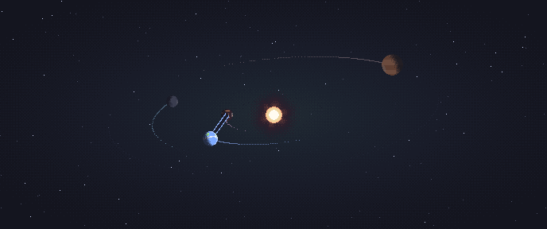
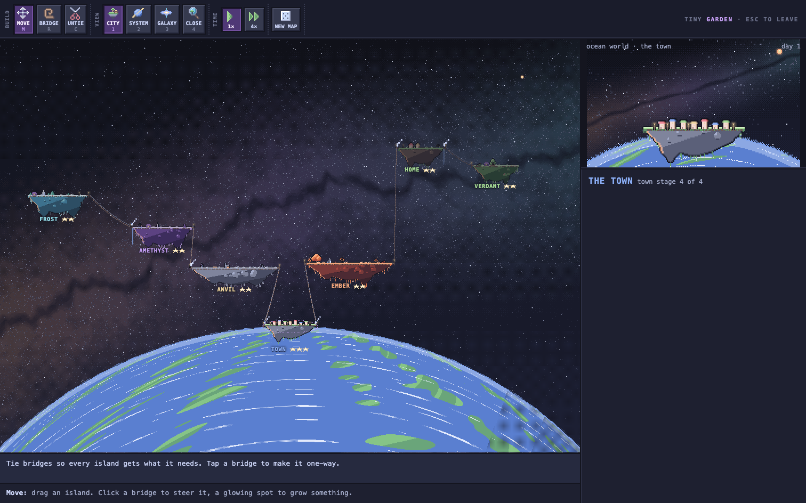
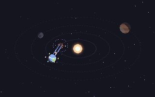
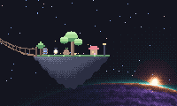

# Tiny Garden

A pixel-art world that lives on your macOS desktop as a live wallpaper, and turns into a playable game on one key.



## The four views

| 1 City | 2 System | 3 Galaxy | 4 Close |
| --- | --- | --- | --- |
|  |  |  |  |

## Modes

- **Wallpaper**: the world runs behind your windows. Clicks pass through.
- **Play**: the garden takes the keyboard and mouse. Build, connect and grow.

## How v2 plays

- **Three goods: water, light and stone.** Each island makes one of them, from its type (HOME and ANVIL stone,
  EMBER and AMETHYST light, FROST and VERDANT water). An island grows by receiving the two it doesn't make. Goods
  are used the moment they arrive: you only ever see them as the backpack colour of the little astronaut carrying
  them, never lying on an island.
- **Bridges** are free. Each one lands at a pier with a lantern post; an island starts with 2 piers and gains more
  as it grows, and the town has 4. A bridge can only span the island's reach (hovering an island shows it). Walkers
  carry a good toward the nearest island that needs it, and an island on the way takes its share first. An island
  only makes its good while someone it can reach still needs it; otherwise its walker rests on its pier.
- **One-way bridges.** Tap a bridge to cycle it through both ways, A to B only and B to A only, to steer a supply
  past an island.
- **Stages, spots and picks.** Four stages: bare rock, grass, a home, full bloom. Each stage up opens 1 or 2 spots
  on the island's top, which glow in play mode. Click one for a card of 2 or 3 picks. A spot next to a pier offers
  picks that suit the good arriving there (a waterfall, lanterns, a stair); middle spots offer homes, trees and
  gardens from the island's type. Some picks make the island send a second good. A pick is kept for good. In
  wallpaper mode an island still grows; its new spots wait for you.
- **Renaming.** Select an island and give it a name in its panel.
- **Events and gifts.** About once every 6 hours a space whale drifts past, a traveller sails in, or an aurora
  fills the sky, in either mode. Each leaves a gift (song coral, a neighbour's hut, sky banners) in a tray of 3;
  place it on an open spot in play mode. Each gift has one small perk.
- **The town** on TIDE's horizon grows in stages too, from all three goods.
- **The cable.** When every TIDE island is at stage 3 or more, deliver all three goods to the town to build the
  cable to CINDER, which then plays the same way with its own islands.
- The guide in play mode teaches each step, and says when a layout leaves an island unable to get a good.

## Keys

| Key | Does |
| --- | --- |
| Option+E | toggle wallpaper and play (bound in skhd) |
| Esc | back out of the current thing; leaves play mode |
| M / R / C | move, bridge, untie tools |
| 1 2 3 4 | city, system, galaxy, close view |
| Tab | next view |
| N | show or hide names (remembered) |

## Build and install

Needs macOS 14+ and the Xcode Command Line Tools.

```
scripts/install
```

This builds, assembles `~/Applications/Tiny Garden.app`, links `~/.local/bin/tiny-garden`, and loads the LaunchAgent `local.tiny-garden` so it runs at login.

## CLI

```
tiny-garden toggle   # wallpaper <-> play
tiny-garden quit     # save and exit
tiny-garden status   # mode, window and screen details
```

## Uninstall

```
tiny-garden quit
launchctl bootout gui/$UID/local.tiny-garden
rm -rf ~/Applications/Tiny\ Garden.app ~/Library/LaunchAgents/local.tiny-garden.plist ~/.local/bin/tiny-garden
```

## Saves

`~/Library/Application Support/tiny-garden/`: `save.json` (live), `save.prev.json` (the map before "New map"), `save.v1.json` (a v1 save, set aside when v2 first starts), `save.bad-YYYYMMDD-HHMMSS.json` (each unreadable save, kept).

## Tests

```
npm test
```

## Contributing art

Read [docs/ART.md](docs/ART.md) first. The look is guarded. See also [docs/design.md](docs/design.md) and [docs/plan.md](docs/plan.md).

MIT licensed.
